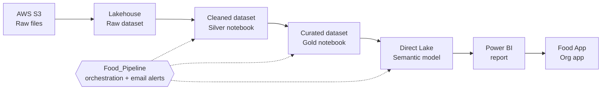
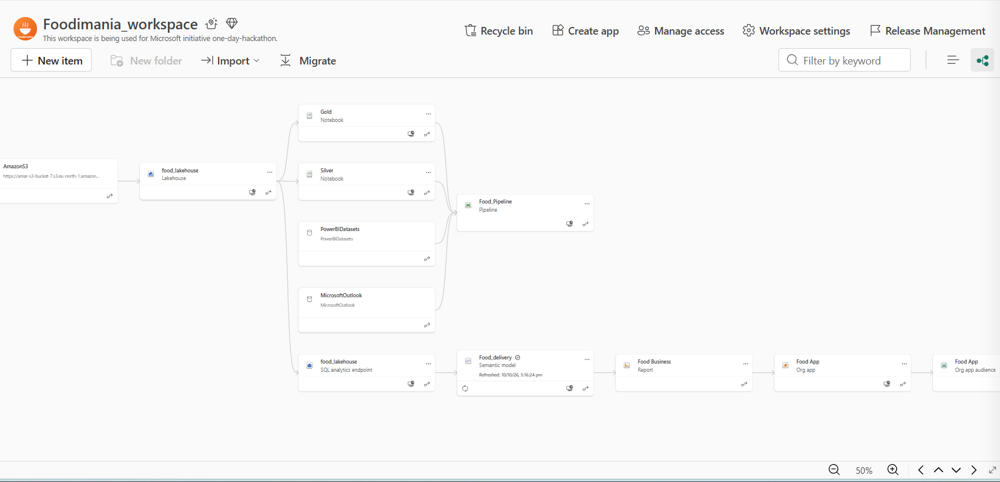
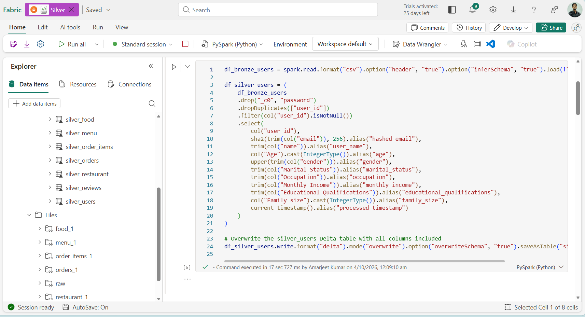
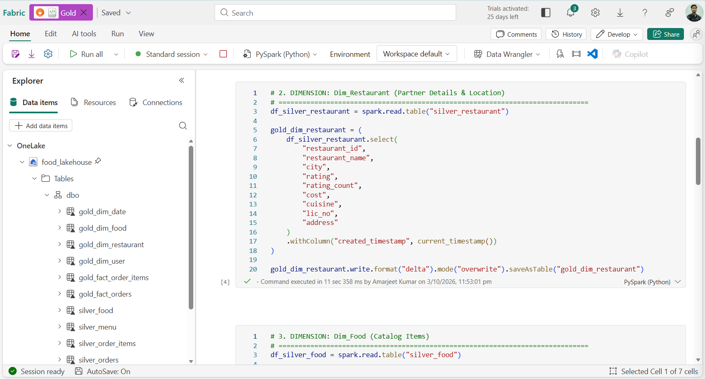
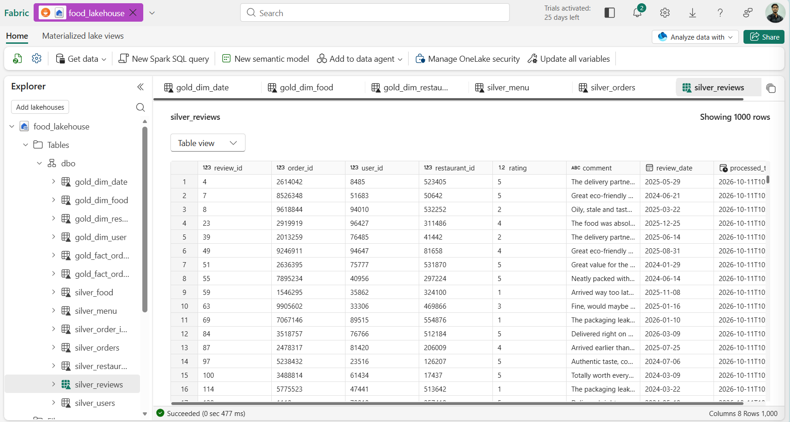
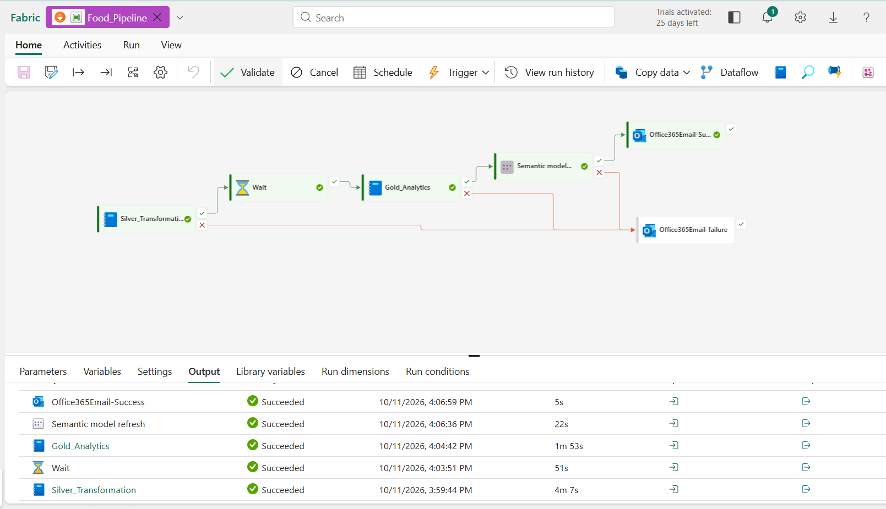
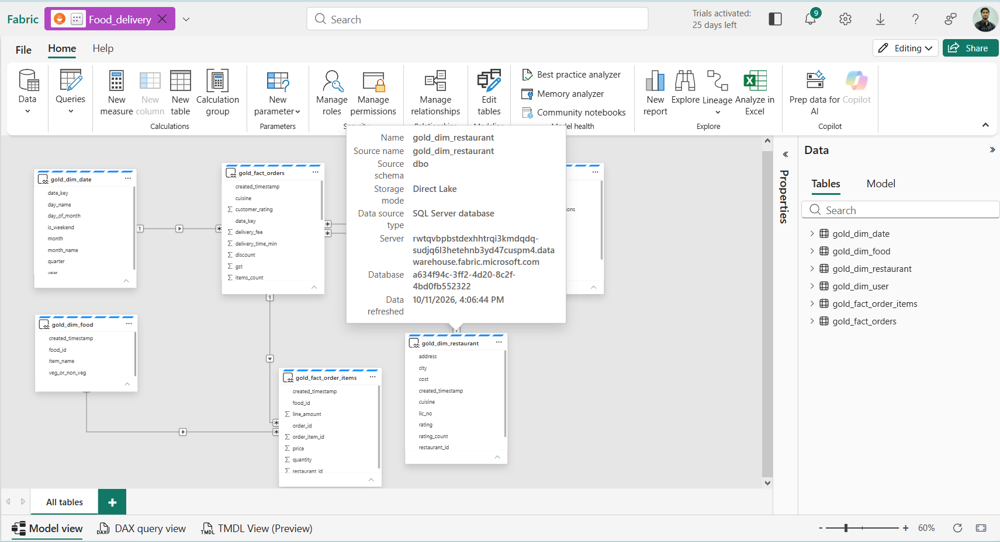
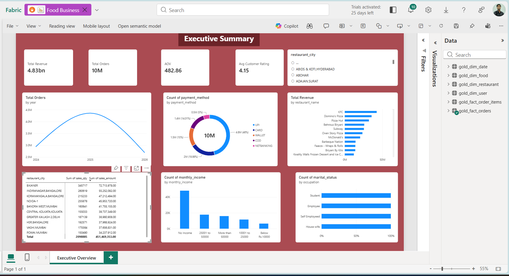
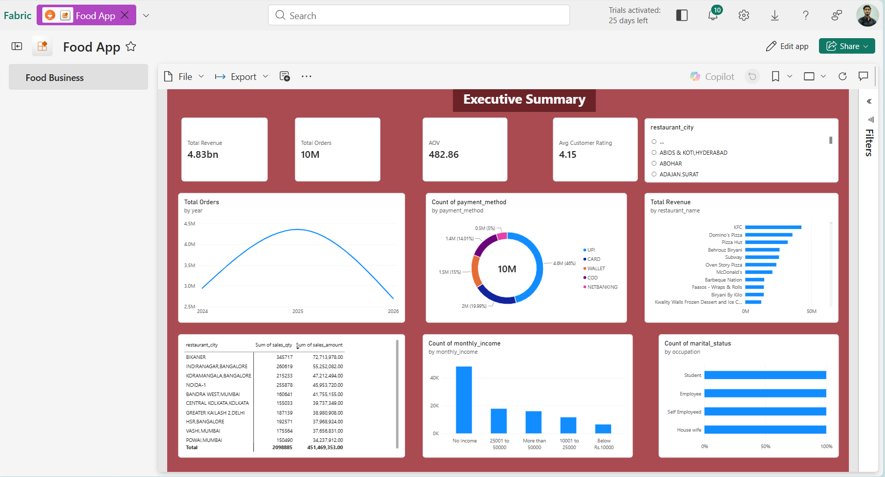

  

<h1 align="center">Data Engineering on Microsoft Fabric</h1>

<b>Foodimania</b>: end-to-end analytics for 10 million food delivery orders, from AWS S3 to a shared Power BI app.

---

## Overview

Foodimania is a fictional food delivery platform whose order data sat as raw files in AWS S3, with duplicates, mixed data types and plain-text passwords. This project turns that data into a **trusted, secure and always-current analytics product** using a **Raw → Cleaned → Curated** architecture on Microsoft Fabric.

Built for the Microsoft Fabric One-Day Hackathon as part of the B.Sc. (Hons) Data Science and AI programme, IIT Guwahati.

## Architecture

| Layer | What happens |
|---|---|
| **Raw** | S3 files surfaced in `food_lakehouse` through OneLake; kept untouched |
| **Cleaned** | De-duplicate, drop null keys, remove password, hash email (SHA-256), cast types |
| **Curated** | Star schema of 6 Delta tables built for analytics |

**Tech stack:** AWS S3 · OneLake · PySpark · Delta Lake · Fabric Pipeline · Direct Lake · DAX · Power BI

## Workspace Lineage

## Data Pipeline

### Cleaned layer
PySpark notebook that cleans the users table. It uses `select()` with aliases instead of `drop()` because Spark column names are case-insensitive.

### Curated layer
Builds the star schema: `gold_dim_date`, `gold_dim_food`, `gold_dim_restaurant`, `gold_dim_user`, `gold_fact_orders`, `gold_fact_order_items`.

### Lakehouse tables

### Automation
`Food_Pipeline` runs the Silver notebook, waits, runs the Gold notebook, refreshes the semantic model, and sends a success or failure email. A full run takes about 7 minutes.

## Data Model

Direct Lake semantic model `Food_delivery`: no data import, no copy. All relationships are many-to-one with a single filter direction.

| Fact | Dimension | Key |
|---|---|---|
| `gold_fact_orders` | `gold_dim_user` | `user_id` |
| `gold_fact_orders` | `gold_dim_restaurant` | `restaurant_id` |
| `gold_fact_orders` | `gold_dim_date` | `date_key` |
| `gold_fact_order_items` | `gold_fact_orders` | `order_id` |
| `gold_fact_order_items` | `gold_dim_food` | `food_id` |

**Key DAX measures:** Total Revenue, Total Orders, AOV, Avg Customer Rating, Avg Delivery Time.

## Results

| Total revenue | Total orders | Avg order value | Avg rating |
|:---:|:---:|:---:|:---:|
| **4.83bn** | **10M** | **482.86** | **4.15** |

UPI is the leading payment method at 46% of orders.

## Delivery

The report is published as the **Food App** (Power BI organizational app) with role-based access, so users see one clean page instead of notebooks and tables.

## Governance

- Semantic model **Promoted** (endorsed) as the trusted source
- Native Fabric **lineage** from S3 to app
- **PII protection**: password dropped, email hashed
- Workspace roles: Admin, Member, Viewer

## Challenges Solved

| Issue | Fix |
|---|---|
| `age`, `gender`, `occupation` vanished after `drop()` | Use `select()` with `alias()` |
| Delta schema mismatch on rewrite | Add `overwriteSchema = true` |
| Relationship type error (Int64 vs String) | Cast key columns to string |
| Calculated table error for a measure | Create measures with **New measure** |

## Future Work

Scheduled and incremental loads · data quality checks · Microsoft Purview integration · predictive models for delivery time and demand

## Author

**Amarjeet Kumar**, B.Sc. (Hons) Data Science and AI, IIT Guwahati
